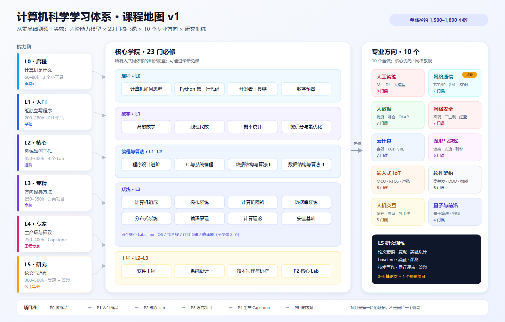
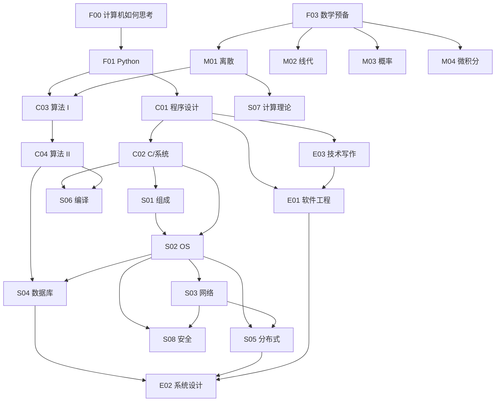

# 02 · 全局课程地图



## 1. 一张图看懂

```
                          ┌──────────────────────────────────────────────┐
                          │              研究训练（L5）                   │
                          │   论文精读 · 复现 · 实验设计 · 写作 · 答辩      │
                          └──────────────────────▲───────────────────────┘
                                                 │
        ┌────────────────────────────────────────┴────────────────────────────────────────┐
        │                          10 个专业方向（L3–L5，选 1–2 个）                        │
        │  AI · 网络通信 · 大数据 · 网络安全 · 云计算 · 图形学与游戏                        │
        │  嵌入式与 IoT · 软件架构 · 人机交互 · 量子计算与前沿                              │
        └────────────────────────────────────────▲────────────────────────────────────────┘
                                                 │
        ┌────────────────────────────────────────┴────────────────────────────────────────┐
        │                     核心学院（L1–L2，所有人必修）                                 │
        │  数学：离散 · 线代 · 概率 · 微积分        编程：Python · C · 算法 I/II            │
        │  系统：组成 · OS · 网络 · 数据库 · 分布式  理论：计算理论 · 编译原理               │
        │  工程：软件工程 · 系统设计 · 技术写作      安全：安全基础                          │
        └────────────────────────────────────────▲────────────────────────────────────────┘
                                                 │
        ┌────────────────────────────────────────┴────────────────────────────────────────┐
        │                          启程（L0，零基础）                                      │
        │        计算机如何思考 · Python 第一行代码 · 开发者工具链 · 数学预备               │
        └──────────────────────────────────────────────────────────────────────────────────┘
```

三条纵轴：

- **能力阶**：L0 启程 → L1 入门 → L2 核心 → L3 专精 → L4 专家 → L5 研究；
- **课程层级**：核心必修 → 方向专精 → 研究训练；
- **项目线**：P0 微作品 → P1 入门作品 → P2 核心 Lab → P3 方向项目 → P4 生产级 Capstone → P5 研究项目。

---

## 2. 核心学院：23 门必修课

核心课不是「所有人都要学完的 23 门」，而是「所有方向共同依赖的知识底座」。
大学生可以按诊断跳过已掌握的部分；高中生建议完整走。

### 2.1 L0 启程（4 门 / 22 模块 / 100 课时）

| ID | 课程 | 模块 | 课时 | 先修 | 一句话目标 |
| --- | --- | ---: | ---: | --- | --- |
| F00 | 计算机如何思考 | 6 | 24 | 无 | 建立「程序、硬件、网络、AI、计算边界」的全景直觉 |
| F01 | Python 第一行代码 | 8 | 40 | 无 | 能写 100 行左右的程序，解决身边的小问题 |
| F02 | 开发者工具链 | 4 | 16 | 无 | 会用命令行、编辑器、Git、调试器，能独立排错 |
| F03 | 数学预备 | 4 | 20 | 无 | 补齐函数、指数对数、集合逻辑、概率直觉 |

### 2.2 L1 入门（8 门 / 53 模块 / 261 课时）

| ID | 课程 | 模块 | 课时 | 先修 | 一句话目标 |
| --- | --- | ---: | ---: | --- | --- |
| M01 | 离散数学 | 8 | 40 | F03 | 能用逻辑、集合、组合、图论表达并证明 CS 问题 |
| M02 | 线性代数 | 6 | 30 | F03 | 理解向量空间、矩阵变换、特征值、SVD 的几何意义 |
| M03 | 概率统计 | 6 | 30 | F03 | 能建模不确定性，做估计、检验与贝叶斯推断 |
| M04 | 微积分与最优化 | 6 | 30 | F03 | 理解导数、梯度、积分，能推导梯度下降 |
| C01 | 程序设计进阶 | 8 | 40 | F01 | 能写结构清晰、可测试的 300–500 行程序 |
| C02 | C 与系统编程 | 7 | 35 | C01 | 理解指针、内存、编译链接、进程与系统调用 |
| C03 | 数据结构与算法 I | 8 | 40 | C01、M01 | 掌握线性结构、哈希、树、堆、排序、二分与贪心 |
| E03 | 技术写作与协作 | 4 | 16 | F02 | 能写清楚文档、画对图、做技术表达与协作 |

### 2.3 L2 核心（11 门 / 90 模块 / 450 课时）

| ID | 课程 | 模块 | 课时 | 先修 | 一句话目标 |
| --- | --- | ---: | ---: | --- | --- |
| C04 | 数据结构与算法 II | 8 | 40 | C03、M01 | 掌握图、DP、高级结构、字符串算法与 NP 完全性 |
| S01 | 计算机组成与体系结构 | 10 | 50 | C02 | 从逻辑门到 CPU、缓存、虚拟内存、多核与性能 |
| S02 | 操作系统 | 10 | 50 | C02、S01 | 能解释并实现进程、调度、内存、文件、IO、虚拟化 |
| S03 | 计算机网络 | 10 | 50 | C02、M03 | 从信号到 TCP/IP、HTTP/TLS，能抓包、排障、设计网络 |
| S04 | 数据库系统 | 10 | 50 | C04、S02 | 从关系模型到存储、索引、查询优化、事务、分布式 |
| S05 | 并行与分布式系统 | 8 | 40 | S02、S03 | 理解并发、复制、共识、分布式存储与事务 |
| S06 | 编译原理 | 8 | 40 | C02、C04 | 能实现词法/语法/语义/优化/代码生成的迷你编译器 |
| S07 | 计算理论 | 6 | 30 | M01 | 理解自动机、可计算性、P/NP 与复杂度 |
| S08 | 安全基础 | 6 | 30 | S02、S03 | 建立威胁建模、密码学、Web/系统/网络安全基础 |
| E01 | 软件工程 | 8 | 40 | C01、E03 | 能从需求到上线，掌握测试、CI/CD、可观测性 |
| E02 | 系统设计 | 6 | 30 | S04、S05、E01 | 能做容量估算、架构取舍、高可用与安全设计 |

> 核心课合计：**23 门 / 165 模块 / 811 课时 / 约 810 小时**。
> 加上实验、项目、复习与考试，核心阶段实际投入约 **1,000–1,100 小时**。
> C02 与 E03 跨越 L1/L2；S05/S06 跨越 L2/L3，按方向需要加深。
>
> 按 [00 决策](00-decisions.md)，核心分两批建设：
> **Core v1（15 门 / 555 课时）** 先完成，**Core v2（8 门 / 256 课时）** 随后补齐。

### 2.4 核心课之间的「三条主线」

**主线 A：编程与算法**

```
F01 Python → C01 程序设计 → C03 算法 I → C04 算法 II → S06 编译原理
                     ↘ C02 C/系统 → S01 组成 → S02 OS
```

**主线 B：数学与理论**

```
F03 数学预备 → M01 离散 → M02 线代 → M03 概率 → M04 微积分
                     ↘ S07 计算理论
                     ↘ 方向课（AI/图形/密码/量子）
```

**主线 C：系统与工程**

```
C02 C/系统 → S01 组成 → S02 OS → S03 网络 → S04 数据库
                                      ↘ S05 分布式 → E02 系统设计
                     S08 安全 ←──────┘
E01 软件工程 ← C01
```

### 2.5 核心课的「不可跳过」清单

以下课程是后续方向的硬门槛，不建议跳过（可通过诊断免修，但不能「没学过」）：

- **M01 离散数学 + C03/C04 算法**：所有方向；
- **S01 组成 + S02 OS**：系统、网络、安全、云、嵌入式、数据库；
- **S03 网络**：网络、安全、云、分布式、后端；
- **S04 数据库**：大数据、后端、架构、AI 数据工程；
- **M02 线代 + M03 概率 + M04 微积分**：AI、图形、量子、数据；
- **S05 分布式**：云、大数据、架构、分布式存储；
- **E01 软件工程**：所有工程方向。

---

## 3. 十个专业方向

每个方向由「入口桥接课 + 3–4 门核心课 + 2–3 门高级课 + 研究课」组成。
方向不是「看完所有课」，而是「达到该方向的 L4/L5 出口能力」。

| 方向 | 课程数 | 模块 | 课时 | 入口先修 | L4 出口项目 |
| --- | ---: | ---: | ---: | --- | --- |
| D1 人工智能 | 8 | 58 | 290 | M02/M03/M04、C04 | 生产级 RAG/Agent 或训练/推理系统 |
| D2 网络通信 | 7 | 48 | 240 | S03、C02 | 可编程网络/高性能网关/测量平台 |
| D3 大数据 | 7 | 47 | 235 | S04、S05、C01 | 实时湖仓/数据平台 |
| D4 网络安全 | 7 | 48 | 240 | S02、S03、S08 | 红蓝对抗/安全平台/漏洞研究 |
| D5 云计算 | 7 | 49 | 245 | S02、S03、E01 | 云原生平台/SRE 体系 |
| D6 图形学与游戏 | 6 | 44 | 220 | M02、C02/C04 | 渲染器/游戏引擎模块 |
| D7 嵌入式与 IoT | 6 | 42 | 210 | C02、S01 | 实时设备/边缘网关 |
| D8 软件架构 | 6 | 37 | 185 | E01、S04、S05 | 高并发系统/架构治理 |
| D9 人机交互 | 5 | 29 | 145 | E01、基础前端 | 完整产品交互与可用性评估 |
| D10 量子计算与前沿 | 4 | 22 | 110 | M01/M02/M03、S07 | 量子算法复现/前沿论文 |

> 方向课合计：**63 门 / 424 模块 / 约 2,120 课时**。
> 全站合计：**86 门 / 589 模块 / 约 2,930 课时**。
> 单个学习者通常只选 1 个主方向 + 1 个辅方向（辅方向只学入口 + 2 门核心课）。

### 3.1 方向建设顺序（已锁定）

**10 个方向全做，但不是同时开工。** 先完成核心（Core v1 → Core v2），再按下列顺序推进；
网络通信是唯一允许在核心阶段提前做的方向（因为 S03 本身就是核心课）。

| 顺序 | 方向 | 启动条件 | 理由 |
| ---: | --- | --- | --- |
| 1 | 网络通信 | S03 核心课开课时 | 第一旗舰；可视化/实验/真实系统最强 |
| 2 | 人工智能 | Core v1 完成 + M02/M03/M04 | 需求最大；依赖数学与系统工程 |
| 3 | 大数据 | Core v1 + S04/S05 | 依赖数据库/分布式；可与 AI 共用数据管道 |
| 4 | 网络安全 | Core v1 + S08 | 依赖 OS/网络/安全基础 |
| 5 | 云计算 | Core v1 + S05/S08 | 依赖 OS/网络/分布式/安全 |
| 6 | 图形学与游戏 | Core v1 + M02/C02 | 依赖线代/C++/性能 |
| 7 | 嵌入式与 IoT | Core v1 + S01/C02 | 依赖组成/系统编程 |
| 8 | 软件架构 | Core v1 + E01/S04/S05 | 依赖工程/数据库/分布式 |
| 9 | 人机交互 | Core v1 + E01 | 依赖工程基础 + 用户研究 |
| 10 | 量子计算与前沿 | Core v2 + M01/M02/M03/S07 | 依赖数学/计算理论 |

> 方向内部的课程顺序见 [04 专业方向大纲](04-specializations.md)；
> 时间排期见 [09 核心优先执行计划](09-core-first-plan.md)。

### 3.2 方向选择建议

| 如果你喜欢… | 优先考虑 | 因为 |
| --- | --- | --- |
| 数学、模型、论文 | AI、量子计算 | 需要线代/概率/优化与论文阅读 |
| 拆系统、抓包、调性能 | 网络通信、云计算、分布式 | 需要 OS/网络/并发功底 |
| 数据、SQL、业务分析 | 大数据、软件架构 | 需要数据库/分布式/工程能力 |
| 攻防、逆向、CTF | 网络安全 | 需要系统/网络/密码学 |
| 画面、引擎、GPU | 图形学与游戏 | 需要线代/图形学/C++ |
| 硬件、机器人、实时性 | 嵌入式与 IoT | 需要组成/嵌入式 C/RTOS |
| 产品、设计、用户 | 人机交互 | 需要工程基础 + 用户研究 |
| 带团队、做架构 | 软件架构 | 需要多年工程经验（建议有项目后再选） |

---

## 4. 先修关系

### 4.1 硬先修（不满足会学不懂）



### 4.2 软先修（可以并行，但建议先接触）

| 课程 | 软先修 | 原因 |
| --- | --- | --- |
| S01 组成 | M01 离散 | 逻辑门、布尔代数会用到 |
| S03 网络 | M03 概率 | 排队、丢包、拥塞控制会用到 |
| S04 数据库 | C04 算法 | B+ 树、排序、连接算法会用到 |
| S06 编译 | S01 组成 | 寄存器、指令、调用约定会用到 |
| S08 安全 | S04 数据库 | SQL 注入、权限模型会用到 |
| E02 系统设计 | S03 网络 | 负载均衡、CDN、超时会用到 |
| 所有方向 | E03 技术写作 | 项目文档、论文笔记、答辩都需要 |

### 4.3 方向入口条件

| 方向 | 必须已学 | 建议已学 |
| --- | --- | --- |
| AI | M02、M03、M04、C04 | S05、E01 |
| 网络通信 | S03、C02 | S02、S05 |
| 大数据 | S04、S05、C01 | E01、M03 |
| 网络安全 | S02、S03、S08 | S04、C02 |
| 云计算 | S02、S03、E01 | S05、S08 |
| 图形学与游戏 | M02、C02 或 C04 | S01、E01 |
| 嵌入式与 IoT | C02、S01 | S02、S03 |
| 软件架构 | E01、S04、S05 | S03、S08 |
| 人机交互 | E01、基础前端 | 心理学/设计基础（可选） |
| 量子计算 | M01、M02、M03、S07 | M04 |

---

## 5. 四条推荐路径

### 5.1 高中生路径（6 年，业余）

| 阶段 | 时间 | 内容 | 里程碑 |
| --- | --- | --- | --- |
| 高一上 | 6 个月 | F00–F03 + C01 | 能写 Python 小工具；理解程序如何运行 |
| 高一下–高二上 | 12 个月 | C03、M01、M02、M03、C02 | 算法入门；能写 C；数学跟上课内进度 |
| 高二下–高三上 | 12 个月 | C04、S01、S02、S03、E01 | 四个核心 Lab 中完成 2 个 |
| 高三下–大一 | 12 个月 | S04、S05、E02 + 方向入口 | 系统设计；确定方向 |
| 大二–大三 | 18 个月 | 方向核心 + 高级课 | 方向 Capstone |
| 大四 | 12 个月 | 方向 L5 + 研究项目 | 论文复现 + 原创项目 |

> 高中生不需要「全部学完」，重点是 L0–L2 的基础与兴趣。数学可以随课内进度补。

### 5.2 大学生路径（3.5 年，主修 CS）

| 学年 | 内容 | 里程碑 |
| --- | --- | --- |
| 大一 | F01–F03、C01、C03、M01–M04 | 编程与数学地基；GPA/项目 |
| 大二 | C02、C04、S01、S02、S03、S04 | 四大件 Lab；确定方向 |
| 大三 | S05、S06/S07、S08、E01、E02 + 方向核心 | 方向项目；实习 |
| 大四 | 方向高级 + L5 研究/毕业设计 | Capstone + 论文/答辩 |

### 5.3 转行者路径（18–24 个月，全职投入）

| 阶段 | 时间 | 内容 | 说明 |
| --- | --- | --- | --- |
| 诊断 | 1 周 | 编程/数学/系统诊断 | 跳过已掌握内容 |
| 地基 | 3 个月 | C01、C03、M01（按需）、F02 | 先能写、能分析 |
| 核心 | 6 个月 | C02、C04、S01、S02、S03、S04 | 系统能力是转行分水岭 |
| 工程 | 2 个月 | E01、E02、E03 | 项目与协作 |
| 方向 | 6 个月 | 方向 3–4 门核心课 | 选 AI/后端/云/安全/数据 |
| 作品 | 3 个月 | P4 Capstone | 可上线、可讲清 |

### 5.4 研究生/在职强化路径（12–18 个月）

| 阶段 | 时间 | 内容 | 里程碑 |
| --- | --- | --- | --- |
| 方向诊断 | 1 周 | 方向核心概念 + 代码阅读 | 生成缺口清单 |
| 方向核心 | 4 个月 | 3–4 门方向核心课 | 能复现经典方法 |
| 高级专题 | 4 个月 | 2–3 门高级课 + 论文精读 | 能评价论文 |
| 研究 | 6 个月 | 复现 + 原创 + 写作 | 论文级报告/开源项目 |

---

## 6. 规模与时间预算

### 6.1 课程库规模

| 层级 | 课程 | 模块 | 课时 | 说明 |
| --- | ---: | ---: | ---: | --- |
| 核心学院 | 23 | 165 | 811 | 所有人必修（可诊断免修） |
| 10 个方向 | 63 | 424 | 约 2,120 | 每人选 1 主 + 0–1 辅 |
| **全站** | **86** | **589** | **约 2,930** | 完整课程库 |

### 6.2 单个学习者的时间

| 路径 | 课程量 | 正文/实验 | 项目/复习/考试 | 总计 |
| --- | ---: | ---: | ---: | ---: |
| 核心 + 1 方向 + 研究 | 约 30 门 | 约 1,100h | 约 400–700h | **1,500–1,800h** |
| 核心 + 1 方向（工程出口） | 约 28 门 | 约 1,000h | 约 350–500h | **1,350–1,500h** |
| 仅核心（补齐科班基础） | 23 门 | 约 810h | 约 250–350h | **1,050–1,150h** |
| 单方向强化（有 CS 基础） | 7 门 | 约 300h | 约 300–500h | **600–800h** |

> 按每周 10 小时：完整路径约 3 年；按每周 20 小时：约 1.5–2 年。
> 这是「达到能力」的诚实估计，不包含走神、重看、找资料的时间。

### 6.3 内容生产规模

- 1 个完整课时（正文 + 图 + 交互 + 练习 + 审校）约 **3–6 人天**；
- 3,000 课时约 **9,000–18,000 人天**，即 **35–70 人年**；
- 6–8 人内容团队，首年约 400–600 课时，全量需要 **4–6 年**；
- 个人 + AI 辅助，首年约 150–250 课时，全量需要更长时间。

因此路线图（见 08）采用「黄金路径优先」：先把一条完整路径做到高质量，再横向扩展方向。

---

## 7. 课程编号与命名规范

### 7.1 课程 ID

| 前缀 | 含义 | 示例 |
| --- | --- | --- |
| `F` | 启程 Foundation | `F01-python-first` |
| `M` | 数学 Math | `M01-discrete-math` |
| `C` | 编程与算法 Code | `C03-dsa-1` |
| `S` | 系统 Systems | `S03-networking` |
| `E` | 工程 Engineering | `E01-software-engineering` |
| `A` | 人工智能 AI | `A02-deep-learning` |
| `N` | 网络通信 Network | `N01-tcp-ip` |
| `B` | 大数据 Big Data | `B02-spark` |
| `SEC` | 网络安全 Security | `SEC02-binary-security` |
| `K` | 云计算 Cloud | `K03-kubernetes` |
| `G` | 图形学 Graphics | `G02-realtime-rendering` |
| `EM` | 嵌入式 Embedded | `EM02-rtos` |
| `AR` | 软件架构 Architecture | `AR02-high-concurrency` |
| `H` | 人机交互 HCI | `H03-interaction-design` |
| `Q` | 量子 Quantum | `Q02-quantum-algorithms` |

### 7.2 模块与课时 ID

```
course:  S03
module:  S03.transport
lesson:  S03.transport.tcp-handshake
kp:      kp.tcp.three-way-handshake
```

规则：

- 课程 ID 全局唯一，短、稳定、可读；
- 模块 ID 用 `课程.主题`，不使用序号（序号会因调整而失效）；
- 课时 ID 用 `课程.模块.主题`，不使用「第 3 课」；
- 知识点 ID 用 `kp.领域.概念`，跨课程复用；
- 旧 ID 迁移时保留别名（`aliases`），避免已分享链接失效。

### 7.3 命名语气

- 课程名用「名词 + 限定」：`计算机网络`、`计算机组成与体系结构`；
- 模块名用「问题/主题」：`TCP 如何做到可靠传输`，而不是「TCP 概述」；
- 课时名用「可检验的能力」：`用三次握手建立连接`，而不是「三次握手」；
- 避免「深入浅出」「一文搞懂」「保姆级」等营销词。

---

## 8. 「完整」的边界

本框架的「完整」指 **计算机科学核心 + 10 个应用方向的课程体系**，不包括：

- 大学通识（英语、政治、体育、人文）；
- 电子工程的器件/模拟电路深度（只保留数字逻辑与计算机组成所需部分）；
- 数学系的实分析、抽象代数、拓扑（只保留 CS 所需）；
- 所有云厂商/框架的细节（工具会过时，课程讲原理 + 一个代表实现）；
- 学位授予与导师制（提供能力训练，不替代真实研究生院）。

这个边界是刻意的：**保证深度，避免无限膨胀**。
