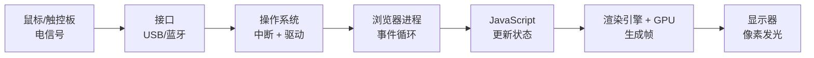

# F00 · 从点击到像素：一次点击的旅程

> **课程**：F00 计算机如何思考 · **模块**：1 从点击到像素
> **课时 ID**：`F00.overview.click-to-pixel`
> **时长**：30 分钟正文 + 20 分钟实验
> **难度**：L0 / 1 星
> **先修**：无
> **核心知识点**：输入、中断、操作系统、进程、事件、GPU、像素、抽象分层

> 这是 F00 的第一节，也是整个体系的「钩子」：
> 在写代码之前，先看见一台计算机是怎样协作的。

---

## 1. 本课问题：你点一下鼠标，发生了什么？

你打开一个网页，点击「点赞」按钮。

按钮变蓝了，数字从 42 变成 43。整个过程不到 0.1 秒。

在这 0.1 秒里，发生了很多事：

- 鼠标怎么知道你在点？
- 信号怎么进入电脑？
- 操作系统怎么知道「有人点了」？
- 浏览器怎么知道「点的是这个按钮」？
- 屏幕上的像素怎么变色？

这一课只解决一个问题：

> **一次点击，怎样穿过硬件、操作系统、浏览器，最后变成屏幕上的一个像素？**

学完这一课，你应该能：

- 画出「点击 → 像素」的完整链路；
- 说出 CPU、内存、操作系统、GPU、显示器各自负责什么；
- 解释「抽象分层」：为什么写网页的人不需要懂晶体管；
- 在「点了没反应」时，知道该从哪几层排查。

---

## 2. 先猜一猜

你点击鼠标时，**最先**发生的是哪件事？

- A. 浏览器执行 JavaScript
- B. 屏幕上的像素变色
- C. 鼠标/触控板产生电信号，通过接口进入电脑
- D. CPU 直接画图

<details>
<summary>答案与为什么</summary>

**C。**

顺序大致是：

```
鼠标/触控板 → 接口（USB/蓝牙/触控板）→ 中断 → 操作系统驱动
→ 输入事件 → 浏览器进程 → JavaScript/渲染 → GPU → 显示器
```

A 和 B 都在后面；D 是常见误解——CPU 不直接画屏幕，GPU/显示控制器负责把帧缓冲送到显示器。
</details>

---

## 3. 直观模型：七层旅程



每一层只关心「上一层给我的输入」和「下一层要的输出」：

| 层 | 输入 | 输出 | 它不关心 |
| --- | --- | --- | --- |
| 鼠标 | 你的手 | 电信号/数据包 | 网页是什么 |
| 接口 | 电信号 | 标准输入事件 | 哪个按钮 |
| OS | 硬件事件 | 进程可读的事件 | 按钮颜色 |
| 浏览器 | 输入事件 | DOM 事件 | 晶体管 |
| JS | 事件 | 新状态 | GPU 怎么画 |
| 渲染/GPU | 状态/场景 | 帧缓冲 | 你点了什么 |
| 显示器 | 帧缓冲 | 光 | 代码是什么 |

这就是**抽象分层**：每层都隐藏下面的复杂性，只暴露简单的接口。

### 读图任务

- 如果鼠标没电了，链路断在哪一层？
- 如果网页卡死但鼠标能动，可能是哪几层？
- 如果画面撕裂/花屏，可能是哪几层？

---

## 4. 拆解机制

### 4.1 输入：从手到电信号

鼠标/触控板里有传感器：

- 机械鼠标：滚球带动编码器；
- 光电鼠标：LED/激光 + 图像传感器，比较前后帧；
- 触控板：电容感应手指位置；
- 触摸屏：电容/电阻/光学。

它们把「移动/点击」变成数字信号，通过 USB、蓝牙、I2C 等接口传给电脑。

### 4.2 中断：CPU 被「叫醒」

CPU 不是一直盯着鼠标。它可能在跑浏览器、音乐、后台更新。

当鼠标有数据时，接口会发一个**中断**（interrupt）：

```
CPU：我正在算东西
硬件：叮！有输入
CPU：保存现场 → 跳到中断处理程序 → 处理完 → 回到刚才
```

中断让 CPU 可以「同时」处理很多设备，而不需要轮询每个设备。

### 4.3 操作系统：把硬件事件变成「事件」

操作系统里的**设备驱动**知道怎么和鼠标说话。
它把原始数据翻译成「坐标移动/左键按下」，再放进输入子系统。

然后，操作系统把事件发给**当前获得焦点的窗口**（浏览器）。
浏览器不一定立刻处理；它把事件放进自己的**事件队列**。

### 4.4 浏览器：事件循环

浏览器的主线程有一个**事件循环**：

```
while (true) {
  取出一个任务
  执行它（JS/渲染/输入）
}
```

点击事件是一个任务。浏览器找到「点击位置下面的 DOM 元素」，
触发对应的事件监听器，执行 JavaScript。

JavaScript 更新状态（比如 `likes += 1`），然后请求浏览器重新渲染。

### 4.5 渲染：从 DOM 到像素

浏览器渲染大致分几步：

```
DOM/CSS → 样式计算 → 布局（layout）→ 绘制（paint）→ 合成（composite）→ GPU → 屏幕
```

- **布局**：每个元素放在哪、多大；
- **绘制**：把元素画成图层/指令；
- **合成**：GPU 把图层合成最终画面；
- **显示**：帧缓冲送到显示器，像素发光。

GPU 擅长并行处理大量像素，所以比 CPU 更适合画图。

### 4.6 显示器：像素发光

屏幕由大量像素组成。每个像素有红/绿/蓝子像素，通过亮度组合出颜色。
一帧画面通常是 1920×1080 ≈ 200 万像素；60Hz 屏幕每秒要更新 60 次。

> 你看到的「按钮变蓝」，本质是**几百万个像素的亮度发生了变化**。

---

## 5. 形式化：抽象层次与延迟

### 5.1 抽象层次

```
晶体管 → 逻辑门 → CPU/指令 → 操作系统 → 浏览器 → 网页/JS → 你看到的按钮
```

每一层都建立在下一层之上：

- 写 JS 的人不需要知道 CPU 指令；
- 写 CPU 的人不需要知道网页；
- 但**每一层都有代价**：抽象会隐藏细节，也会隐藏性能问题。

### 5.2 延迟量级

| 操作 | 大致延迟 |
| --- | ---: |
| CPU 一个时钟周期 | ~0.3ns |
| L1 缓存 | ~1ns |
| 内存 | ~100ns |
| SSD 随机读 | ~50–150µs |
| 一次网络往返（同城） | ~1–10ms |
| 人眼可感知的卡顿 | ~16ms（60Hz 一帧） |

> 一次点击到画面更新，通常要控制在 16ms 以内，才会「跟手」。

### 5.3 为什么需要这么多层

因为复杂性无法一次解决。

- 如果写网页要直接操作晶体管，没人能写网页；
- 如果 CPU 要直接理解「点赞」，它就不是通用计算机。

分层让每一层可以独立演进：换 CPU 不影响网页，换浏览器不影响 OS。

---

## 6. 动手实验：测量一次点击

### 环境

浏览器 + 任意文本编辑器；不需要安装。

### 实验 1：点击到绘制的耗时

```html
<button id="btn">点我</button>
<pre id="out"></pre>
<script>
  const btn = document.getElementById('btn');
  const out = document.getElementById('out');

  btn.addEventListener('click', () => {
    const t0 = performance.now();
    btn.textContent = '已点击';
    requestAnimationFrame(() => {
      const t1 = performance.now();
      out.textContent = `点击到下一帧: ${(t1 - t0).toFixed(2)} ms`;
    });
  });
</script>
```

**观察**：耗时通常 < 16ms；如果很大，可能是页面太复杂/设备忙。

### 实验 2：看事件对象

```html
<button id="btn">点我</button>
<script>
  document.getElementById('btn').addEventListener('click', (e) => {
    console.log('坐标', e.clientX, e.clientY);
    console.log('目标', e.target);
    console.log('时间戳', e.timeStamp);
  });
</script>
```

打开开发者工具 Console，点击按钮，观察事件对象。

### 实验 3：看进程/GPU

- Windows：任务管理器 → 性能 → GPU；
- macOS：活动监视器 → GPU；
- Linux：`nvidia-smi` / `intel_gpu_top`；
- 浏览器：`chrome://gpu` 看硬件加速状态。

**任务**：找到「GPU 使用率」在播放视频/滚动页面时的变化。

### 改一改

1. 在点击回调里做一次重计算（比如循环 1e7 次），观察点击到下一帧的延迟；
2. 用 `setTimeout(..., 0)` 替代 `requestAnimationFrame`，比较差异；
3. 关闭浏览器硬件加速，观察滚动/动画是否变慢。

### 弄坏它

- 在点击回调里写 `while(true){}`，页面会卡死（不要在生产页面做）；
- 用开发者工具把 CPU 降速 6 倍，观察交互延迟。

### 排查

| 现象 | 可能原因 |
| --- | --- |
| 点击没反应 | JS 报错/事件没绑定/被遮挡 |
| 点击有延迟 | 主线程忙/长任务/渲染复杂 |
| 画面卡但鼠标能动 | 浏览器渲染卡/GPU 忙 |
| 鼠标完全不动 | 驱动/接口/硬件问题 |

---

## 7. 失败案例：一次「点了没反应」

用户反馈：点击按钮没反应。

排查顺序（从外到内）：

1. **硬件/接口**：鼠标能移动吗？换一个鼠标试试。
2. **OS/驱动**：其他应用能响应点击吗？
3. **浏览器进程**：页面卡死了吗？其他标签页正常吗？
4. **事件绑定**：开发者工具里能看到 click 事件吗？
5. **JS 错误**：Console 有报错吗？
6. **渲染**：状态变了吗？DOM 更新了吗？GPU 正常吗？

**错误做法**：一上来就改 JS。
**正确做法**：先确定「链路断在哪一层」，再修那一层。

---

## 8. 三个常见误区

1. **以为** CPU 直接画屏幕；
   **实际** CPU 准备数据，GPU/显示控制器把帧送到屏幕；
   **因为** 图形是高度并行的任务，GPU 更擅长。

2. **以为** 点击是浏览器「直接处理」的；
   **实际** 先经过硬件、中断、OS 驱动，再到浏览器；
   **因为** 浏览器只是操作系统上的一个进程。

3. **以为** 电脑一次只跑一个程序；
   **实际** OS 在多个进程/线程之间快速切换；
   **因为** 时间片 + 中断 + 调度制造了「同时」的错觉。

---

## 9. 检索练习

### Q1

一次点击的正确顺序是？

- A. JS → GPU → OS → 鼠标
- B. 鼠标 → 接口 → OS → 浏览器 → JS → GPU → 屏幕
- C. 屏幕 → CPU → 鼠标 → OS
- D. 浏览器 → 鼠标 → OS → GPU

<details>
<summary>答案</summary>

**B。**
从硬件输入开始，经过 OS/浏览器/JS/渲染，最后到屏幕。
</details>

### Q2

为什么需要「中断」？

<details>
<summary>答案</summary>

CPU 不需要一直轮询设备；设备有数据时主动通知 CPU，CPU 保存现场、处理、再恢复。
这样 CPU 可以同时管理很多设备。
</details>

### Q3

GPU 在「点击到像素」里负责什么？

<details>
<summary>答案</summary>

把浏览器生成的图层/绘制指令合成最终画面，并行处理大量像素，输出帧缓冲给显示器。
</details>

### Q4

「抽象分层」的好处和代价是什么？

<details>
<summary>答案</summary>

好处：每层只关心简单接口，复杂性被隐藏，层与层可以独立演进。
代价：隐藏细节，可能隐藏性能问题/故障点；排查时要逐层往下。
</details>

### Q5（迁移）

用户说「点击没反应」，你会按什么顺序排查？

<details>
<summary>参考答案</summary>

硬件/接口 → OS/驱动 → 浏览器进程 → 事件绑定 → JS 错误 → 渲染/GPU。
先确认链路断在哪一层，再修那一层。
</details>

---

## 10. 连接与延伸

### 下一课

从算盘到芯片：计算机是怎样从机械计算走到晶体管的。

### 真实系统

- 输入：USB/蓝牙/触摸屏/摄像头；
- OS：中断、驱动、进程、事件；
- 浏览器：事件循环、渲染管线、GPU 合成；
- 性能：16ms 帧预算、长任务、掉帧；
- 排障：任务管理器、`chrome://gpu`、开发者工具 Performance。

### 延伸

- 打开开发者工具 Performance，录一次点击，看看主线程做了什么；
- 读「浏览器渲染原理」；
- 思考：为什么游戏比网页更在意 16ms？

---

## 11. 图与交互 Spec（给可视化工程师）

### 主视觉：`ClickJourney`

**布局**：

```
┌──────────┬──────────┬──────────┬──────────┬──────────┬──────────┐
│ 鼠标      │ 接口      │ OS       │ 浏览器    │ JS/渲染   │ 屏幕      │
│ 电信号    │ USB/蓝牙  │ 中断/驱动 │ 事件循环  │ DOM/GPU  │ 像素      │
└──────────┴──────────┴──────────┴──────────┴──────────┴──────────┘
        →          →          →          →          →          →
```

**交互**：

- 点击「模拟点击」按钮，光点依次穿过六层；
- 点击每一层，展开「输入/输出/它不关心什么」；
- 切换「故障」：鼠标没电/驱动崩溃/JS 报错/GPU 忙，观察链路断点；
- 显示每层延迟量级；
- 切换「抽象视图」：只看接口，不看内部。

**教学点**：让「计算机是一层层抽象」变成可追踪的旅程。

### 辅助图

1. 冯·诺依曼五大部件；
2. 抽象层次金字塔；
3. 浏览器渲染管线；
4. 延迟量级对比。

### 无障碍

- 每层有文字说明；
- 动画可暂停/单步；
- 支持键盘切换层；
- 颜色不唯一依赖。

---

## 12. 生产备注

| 项 | 内容 |
| --- | --- |
| 来源 | CSAPP 第 1 章、浏览器渲染原理、操作系统输入子系统资料 |
| 组件 | `ClickJourney`（可复用至「程序如何运行」「网络请求」） |
| 资产 | 1 个主交互、4 张辅助图、1 个浏览器实验 |
| 工作量 | 4–5 人天 |
| 验收 | 5 名零基础用户中 ≥ 4 人能复述链路；≥ 3 人能说出 3 层以上的职责 |
| 常见失败 | 把 CPU 当画图单元；忽略 OS/驱动；以为浏览器直接读鼠标 |

---

## 13. 本课检查清单

- [x] 一个核心概念：抽象分层
- [x] 真实问题引入（点击点赞）
- [x] 先猜一猜（最先发生什么）
- [x] 主视觉（ClickJourney）
- [x] 分步机制（输入/中断/OS/浏览器/渲染/显示）
- [x] 可运行实验（点击到帧、事件对象、GPU）
- [x] 失败案例（点了没反应）
- [x] 三个误区
- [x] 5 道检索题 + 解析
- [x] 下一课/真实系统/延伸
- [x] 图/交互/无障碍/生产备注
