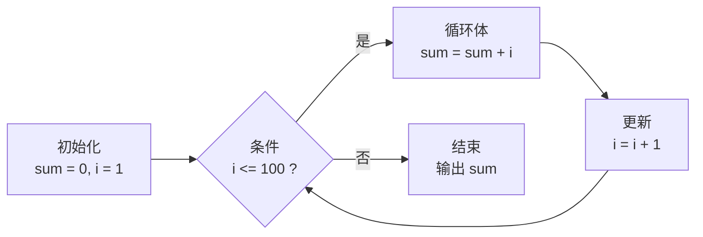

# F01 · 循环：让程序替你重复

> **课程**：F01 Python 第一行代码 · **模块**：3 条件与循环
> **课时 ID**：`F01.control.loops`
> **时长**：30 分钟正文 + 30 分钟实验
> **难度**：L0 / 2 星
> **先修**：变量、类型、`if`
> **核心知识点**：`for`、`while`、`range`、累加器、循环不变式直觉、死循环

> 这是 Phase 0 的完整样课，用来校准「正文 + 图 + 交互 + 实验 + 测评」的标准。
> 不是最终排版；但每一段都可以直接进入内容生产。

---

## 1. 本课问题：100 行代码，还是 4 行？

老师让你算 1 到 100 的和。

你当然可以这样写：

```python
print(1 + 2 + 3 + 4 + 5 + 6 + 7 + 8 + 9 + 10
      + 11 + 12 + 13 + 14 + 15 + 16 + 17 + 18 + 19 + 20
      + 21 + 22 + 23 + 24 + 25 + 26 + 27 + 28 + 29 + 30
      # ... 还有 70 行
      )
```

但只要你写错一个数字，答案就错了；如果要算 1 到 100 万，你根本写不完。

计算机最擅长的事情之一，就是**把同一件事重复做很多次，而且不会烦**。
让程序重复做事的工具，叫**循环**。

这一课只解决一个问题：

> **怎样让程序替你做重复劳动，并且你能准确知道它重复了几次、每次做了什么？**

学完这一课，你应该能：

- 解释 `for` 和 `while` 分别适合什么场景；
- 看到一段循环，能推出它执行几次、最终变量是多少；
- 写出求和、筛选、乘法表，并能修好一个死循环。

---

## 2. 先猜一猜

下面这段代码会打印几个数字？

```python
for i in range(1, 101):
    print(i)
```

- A. 99 个
- B. 100 个
- C. 101 个
- D. 无限个

先选一个，再往下看。

<details>
<summary>答案与为什么</summary>

**B. 100 个。**

`range(1, 101)` 生成的是 `1, 2, 3, ..., 100`。
Python 的 `range(start, stop)` 是**左闭右开**：包含 `start`，不包含 `stop`。

- `range(1, 101)` → 1 到 100，共 100 个；
- `range(1, 100)` → 1 到 99，共 99 个；
- `range(0, 100)` → 0 到 99，共 100 个。

如果你选了 C，说明你把 `stop` 当成了「包含」；
如果你选了 A，说明你少算了起点。
这两种都是最常见的「差一错误」（off-by-one）。
</details>

---

## 3. 直观模型：一台「循环执行器」

先不要背语法。把循环想成一台机器，它有四个状态：



这台机器做四件事：

1. **初始化**：准备好变量，比如 `sum = 0`、`i = 1`；
2. **判断**：条件成立吗？成立就进循环体，不成立就结束；
3. **执行**：做一次循环体，比如把 `i` 加到 `sum`；
4. **更新**：改变量，比如 `i += 1`，然后回到第 2 步。

> 循环不是「跳回去」，而是「状态在时间上重复变化」。
> 你只要盯住两个变量：`i`（走到哪了）和 `sum`（攒了多少）。

### 读图任务

看上面的图，回答：

- 如果 `i` 从 1 开始，第一次进入循环体时 `i` 是几？
- 当 `i = 101` 时，会执行循环体吗？
- 如果删掉「更新」这一步，会发生什么？

---

## 4. 拆解机制

### 4.1 `for`：我知道要遍历什么

`for` 适合「有一个序列，我想逐个处理」：

```python
for i in range(1, 101):
    print(i)
```

`range(1, 101)` 不是「一个数字」，而是一个**序列生成器**：

```python
range(1, 101)      # 1, 2, 3, ..., 100
range(1, 101, 2)   # 1, 3, 5, ..., 99
range(100, 0, -1)  # 100, 99, ..., 1
```

`for` 的工作方式：

1. 从序列里取一个值，赋给 `i`；
2. 执行循环体；
3. 取下一个值；
4. 序列取完了，循环结束。

### 4.2 累加器：把每次的结果攒起来

求和的关键不是 `print`，而是**累加器**：

```python
total = 0
for i in range(1, 101):
    total = total + i
print(total)   # 5050
```

`total = total + i` 可以写成 `total += i`。它的意思是：

> 把「当前的 total」和「当前的 i」加起来，再把结果放回 total。

注意 `total = 0` 必须放在循环**外面**。
如果放在循环里面，每次都会归零，最后只剩最后一个数。

### 4.3 跟踪表：不要在大脑里跑代码

循环最容易错的地方，是「以为自己在跑，其实跑错了」。
拿一张表，手动跟踪前几轮：

| 轮次 | `i` | `total`（执行前） | `total`（执行后） |
| ---: | ---: | ---: | ---: |
| 1 | 1 | 0 | 1 |
| 2 | 2 | 1 | 3 |
| 3 | 3 | 3 | 6 |
| 4 | 4 | 6 | 10 |
| ... | ... | ... | ... |
| 100 | 100 | 4950 | 5050 |

看到规律了吗？

- 第 1 轮后，`total = 1`；
- 第 2 轮后，`total = 1 + 2`；
- 第 3 轮后，`total = 1 + 2 + 3`；
- 第 100 轮后，`total = 1 + ... + 100`。

这就是**循环不变式**的直觉：每一轮结束时，`total` 都等于「从 1 加到当前 `i`」。

### 4.4 `while`：只要条件成立，就继续

`while` 适合「不知道要循环多少次，只知道什么时候停」：

```python
i = 1
total = 0
while i <= 100:
    total += i
    i += 1
print(total)   # 5050
```

`while` 比 `for` 多了一个责任：**你必须自己更新条件变量**。
忘记 `i += 1`，条件永远为真，程序就会一直跑下去。

### 4.5 两种循环怎么选

| 场景 | 推荐 | 例子 |
| --- | --- | --- |
| 遍历一个已知序列 | `for` | 1 到 100、列表里的每个元素 |
| 不知道次数，只知道停止条件 | `while` | 猜数字直到猜对、读到文件末尾 |
| 需要手动控制下标/更新 | `while` | 双指针、滑动窗口 |
| 能用 `for` 就用 `for` | `for` | 更不容易写出死循环 |

---

## 5. 形式化：伪代码与复杂度

`for` 求和可以写成伪代码：

```
total ← 0
for i ← 1 to 100:
    total ← total + i
return total
```

**循环不变式**（用一句话说）：

> 每一轮开始时，`total` 等于「1 到 i-1 的和」。

验证：

- 初始：`i = 1`，`total = 0`，等于「1 到 0 的和」（空和）；
- 每轮：把 `i` 加进 `total`，`i` 变成 `i+1`，不变式仍然成立；
- 结束：`i = 101`，`total` 等于「1 到 100 的和」。

**复杂度**：循环体执行了 100 次，所以是 `O(n)`。
如果把 100 换成 100 万，时间大约变成 1 万倍；但仍然是线性的，不是指数爆炸。

> 这里不要求你写形式化证明。你只要能用「轮次 / i / total」表解释清楚，就算掌握。

---

## 6. 动手实验

### 环境

浏览器 Python 沙箱优先；本地 Python 3.11+ 也可以。

### 实验 1：求和

```python
total = 0
for i in range(1, 101):
    total += i
print(total)
```

**预期输出**：

```
5050
```

### 实验 2：把 101 改成 100

```python
total = 0
for i in range(1, 100):
    total += i
print(total)
```

**预期输出**：

```
4950
```

差在哪里？`range(1, 100)` 只到 99，少了 100。
这就是「差一错误」。

### 实验 3：打印偶数

两种写法，都试一遍：

```python
# 写法 A：用 if 筛选
for i in range(1, 101):
    if i % 2 == 0:
        print(i)

# 写法 B：用 step 直接生成
for i in range(2, 101, 2):
    print(i)
```

**思考**：哪种更清晰？哪种少一次判断？
（答案不唯一；关键是你能说出取舍。）

### 实验 4：9×9 乘法表

```python
for i in range(1, 10):
    row = []
    for j in range(1, 10):
        row.append(f"{i * j:2d}")
    print(" ".join(row))
```

**预期输出**（前两行）：

```
 1  2  3  4  5  6  7  8  9
 2  4  6  8 10 12 14 16 18
```

### 实验 5：100 万次求和要多久

```python
import time

start = time.perf_counter()
total = 0
for i in range(1, 1_000_001):
    total += i
elapsed = time.perf_counter() - start

print(total)
print(f"{elapsed:.4f} 秒")
```

**预期**：输出 `500000500000`，时间因机器而异（通常几十毫秒）。

### 改一改

1. 用 `while` 重写求和；
2. 求 1 到 100 的平方和；
3. 求 1 到 100 的偶数和，不能用 `if`（提示：`range` 的 step）。

### 弄坏它

```python
i = 1
while i <= 100:
    print(i)
    # 故意删掉 i += 1
```

运行后，程序会一直打印。用 `Ctrl+C` 停止。
然后回答：**为什么停不下来？** 哪个变量没有被更新？条件什么时候才会变成假？

### 排查

| 现象 | 可能原因 | 怎么查 |
| --- | --- | --- |
| 结果差 1 | `range` 边界写错 | 打印 `list(range(...))` 看首尾 |
| 结果只剩最后一个数 | `total = 0` 写在循环里 | 看缩进 |
| 程序不结束 | 忘记更新 `i` / 条件写错 | 在循环体里打印 `i` |
| 乘法表不对齐 | 没有格式化宽度 | 用 `f"{n:2d}"` |

---

## 7. 失败案例：三个真实的「循环事故」

### 事故 1：死循环把 CPU 占满

```python
i = 1
while i <= 100:
    print(i)
```

程序不会停。为什么？因为 `i` 永远是 1，`i <= 100` 永远为真。

**错误的心智模型**：「`while` 会自动让 `i` 变大。」
**实际**：`while` 只负责判断，更新是你自己的责任。

### 事故 2：少算最后一个数

```python
total = 0
for i in range(1, 100):   # 以为到 100，其实到 99
    total += i
print(total)              # 4950，不是 5050
```

**错误的心智模型**：「`range(a, b)` 包含 b。」
**实际**：左闭右开，`b` 不包含。

### 事故 3：累加器每次归零

```python
for i in range(1, 101):
    total = 0             # 每次循环都归零
    total += i
print(total)              # 100
```

**错误的心智模型**：「变量写在循环里更安全。」
**实际**：累加器必须在循环外初始化，否则每轮都会清空。

---

## 8. 三个常见误区

1. **以为** `range(1, 100)` 包含 100；
   **实际** 不包含；
   **因为** `range` 是左闭右开。

2. **以为** 循环一定比手写慢；
   **实际** 循环是 `O(n)`，而且比 100 行手写更可维护；
   **因为** 常数时间和增长规模要分开看。

3. **以为** `for` 只能遍历数字；
   **实际** 可以遍历字符串、列表、字典；
   **因为** Python 的 `for` 使用的是「迭代协议」，不是数字专用语法。

---

## 9. 检索练习

### Q1

`for i in range(1, 5): print(i)` 输出什么？

- A. 1 2 3 4 5
- B. 1 2 3 4
- C. 0 1 2 3 4
- D. 1 2 3

<details>
<summary>答案</summary>

**B. 1 2 3 4。**
`range(1, 5)` 包含 1，不包含 5。
</details>

### Q2

下面哪段代码能正确求 1 到 100 的和？

- A. `total = 0; for i in range(1, 100): total += i`
- B. `total = 0; for i in range(1, 101): total += i`
- C. `total = 1; for i in range(1, 101): total += i`
- D. `for i in range(1, 101): total += i`

<details>
<summary>答案</summary>

**B。**
A 少了 100；C 多加了 1；D 没有初始化 `total`。
</details>

### Q3

这段代码为什么停不下来？

```python
i = 0
while i < 10:
    print(i)
```

<details>
<summary>答案</summary>

因为 `i` 没有更新，`i < 10` 永远为真。
在循环体里加 `i += 1` 即可。
</details>

### Q4

填表：`total = 0; for i in range(1, 4): total += i`，第 2 轮后 `total` 是多少？

<details>
<summary>答案</summary>

**3。**
第 1 轮：total = 0 + 1 = 1；
第 2 轮：total = 1 + 2 = 3。
</details>

### Q5（迁移）

求 1 到 100 的偶数和，至少写两种写法，并说明哪种更清晰。

<details>
<summary>参考答案</summary>

写法 A：

```python
total = 0
for i in range(1, 101):
    if i % 2 == 0:
        total += i
print(total)
```

写法 B：

```python
total = 0
for i in range(2, 101, 2):
    total += i
print(total)
```

B 少一次判断、更短；A 更直白地表达「筛选偶数」。
两种都对，关键是能说出取舍。
</details>

---

## 10. 连接与延伸

### 上一课

变量与类型：数据要有名字，才能被反复使用。

### 下一课

函数：把一段循环打包成「可以反复调用的能力」。
你会看到，函数 + 循环 + 条件，已经能写出大部分小工具。

### 真实系统

- 数据处理：`for row in rows:` 逐行处理日志；
- 服务端：`while True:` 接收请求（真正的高并发会用事件循环，不是简单死循环）；
- 算法：排序、搜索、图遍历，底层都是循环。

### 延伸

- 为什么 `sum(range(1, 101))` 也是 `O(n)`？它和手写循环差在哪？
- 如果要求「不能用循环」，你能用等差数列公式 `n(n+1)/2` 吗？复杂度变成什么？
- 下一站：`for` 遍历列表/字典，进入「数据结构」的世界。

---

## 11. 图与交互 Spec（给可视化工程师）

### 主视觉：`LoopStepper`

**布局**：

```
┌──────────────────────┬──────────────────────┬────────────────┐
│ 代码                 │ 循环状态机            │ 变量 / 输出      │
│ 1  total = 0         │  初始化 → 判断        │ i = 1          │
│ 2  for i in range... │    ↑        ↓         │ total = 0      │
│ 3      total += i    │  更新 ← 循环体        │ 输出：          │
│ 4  print(total)      │                      │                │
└──────────────────────┴──────────────────────┴────────────────┘
```

**交互**：

- 上一步 / 下一步 / 播放 / 重置；
- 速度 0.5x / 1x / 2x；
- `n` 滑块：10 / 100 / 1000；
- 开关「删掉 i += 1」：观察死循环（设置安全上限，不真正卡死浏览器）；
- 变量表实时高亮 `i`、`total`；
- 输出区显示累计结果。

**教学点**：让「循环」从语法变成「状态在时间上重复变化」。

### 辅助图

1. `range(1, 101)` 的数轴图：标出包含/不包含；
2. 三个失败案例的对比图：死循环 / 差一 / 归零。

### 无障碍

- 支持键盘单步（←/→）；
- 变量变化有文字说明，不只靠颜色；
- 动画可暂停，尊重 `prefers-reduced-motion`；
- 代码区可复制。

---

## 12. 生产备注

| 项 | 内容 |
| --- | --- |
| 来源 | Python 官方教程（`for`/`range`）、Berkeley CS61A 循环章节 |
| 组件 | `LoopStepper`（可复用至 `while`、递归、排序、图遍历） |
| 资产 | 1 个主交互、2 张辅助图、1 个沙箱、1 个死循环录屏 |
| 工作量 | 3–4 人天（含 5 人试学） |
| 验收 | 5 名零基础用户中 ≥ 4 人能独立写出求和与偶数筛选；≥ 3 人能解释 `range` 边界 |
| 常见失败 | 用户把 `range` 当数组；忘记初始化；缩进错误 |

---

## 13. 本课检查清单

- [x] 一个核心概念：循环
- [x] 真实问题引入
- [x] 先猜一猜，暴露 `range` 误解
- [x] 主视觉（循环执行器）
- [x] 分步机制 + 跟踪表
- [x] 可运行实验 + 预期输出 + 改一改 + 弄坏它
- [x] 三个失败案例
- [x] 三个误区
- [x] 5 道检索题 + 解析
- [x] 上一课/下一课/真实系统
- [x] 图/交互/无障碍/生产备注
