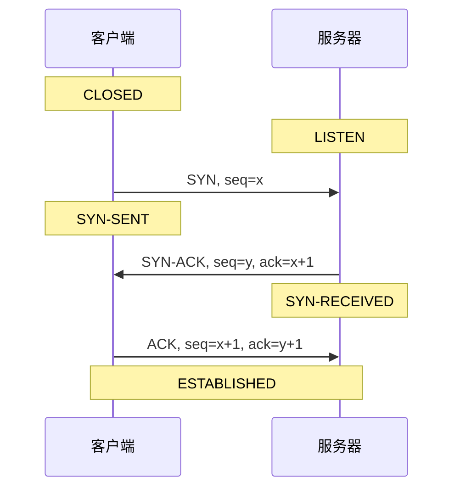

# S03 · TCP 三次握手：两台机器怎样确认「我们都能收发」

> **课程**：S03 计算机网络 · **模块**：6 传输层 UDP/TCP
> **课时 ID**：`S03.transport.tcp-handshake`
> **时长**：35 分钟正文 + 40 分钟实验
> **难度**：L2 / 3 星
> **先修**：IP、端口、socket 基础
> **核心知识点**：三次握手、seq/ack、TCP 状态机、半连接队列、SYN Flood

> 这是 Phase 0 的完整样课，也是网络旗舰课的「内容标准样板」。
> 目标不是背三个包名，而是让学习者能解释「为什么两次不够」，并在抓包里认出它。

---

## 1. 本课问题：0.2 秒内，浏览器和服务器说了哪三句话？

你点开一个网页。

从「按下回车」到「看到页面」，通常只要几百毫秒。在这几百毫秒里，浏览器和服务器
要先完成一次 TCP 连接建立，然后才轮到 HTTP 请求。

连接建立的过程，常被概括成「三次握手」：

```
客户端 → 服务器：SYN
服务器 → 客户端：SYN-ACK
客户端 → 服务器：ACK
```

但背下这三个词，并不等于理解。真正的问题是：

> **为什么是三次？两次不够吗？这三次到底确认了什么？**

学完这一课，你应该能：

- 画出双方状态迁移，解释每个包的作用；
- 说清「两次握手」会留下什么问题；
- 在 Wireshark/tcpdump 中认出三次握手，读出 seq/ack；
- 解释 SYN Flood 攻击为什么能打满服务器。

---

## 2. 先猜一猜

如果只握手两次——客户端发 SYN，服务器回 SYN-ACK，就认为连接建立——可能会发生什么？

- A. 服务器会一直等待，什么也做不了
- B. 可能建立重复连接，或服务器单方面认为连接已建立
- C. 无法加密，所以不安全
- D. 没有任何影响，两次就够了

先选一个，再往下看。

<details>
<summary>答案与为什么</summary>

**B。**

两次握手时，服务器发出 SYN-ACK 后就认为连接建立了；
但客户端可能根本没收到这个 SYN-ACK，或者收到了却不承认。
服务器会为一个「客户端不知道」的连接分配资源，造成半开连接/重复连接。

更本质地说：三次握手要确认的是**双方都能收、都能发**。
两次只能确认「客户端能发、服务器能收」和「服务器能发」，但无法确认「客户端能收」。

C 是常见误解：加密是 TLS 的事，不是 TCP 握手的目的。
</details>

---

## 3. 直观模型：两个状态机，三个包

### 3.1 三个包分别在说什么



用自然语言翻译：

1. **客户端 → 服务器：SYN**
   「我想建立连接。我的起始序号是 x。你能收到吗？」
2. **服务器 → 客户端：SYN-ACK**
   「我收到了你的 x。我也准备好了，我的起始序号是 y。你能收到吗？」
3. **客户端 → 服务器：ACK**
   「我收到了你的 y。我们开始吧。」

### 3.2 三次握手到底确认了什么

把「能发」和「能收」拆成四个方向：

| 能力 | 由谁确认 | 哪个包确认 |
| --- | --- | --- |
| 客户端能发 | 服务器 | 收到 SYN |
| 服务器能收 | 服务器 | 收到 SYN |
| 服务器能发 | 客户端 | 收到 SYN-ACK |
| 客户端能收 | 服务器 | 收到第三次 ACK |

两次握手只能确认前三个方向，**缺少「客户端能收」的确认**。
第三次 ACK 就是客户端告诉服务器：「我收到你的 SYN-ACK 了。」

### 3.3 为什么初始序号要随机

如果每次 ISN 都从 0 开始，旧连接延迟到达的包可能被新连接误认成有效数据。
随机 ISN 能降低这种「旧包串到新连接」的概率，也增加攻击者猜测序列号的难度。

> 注意：SYN 会消耗一个序号。所以客户端发 `SYN seq=x` 后，
> 第三次 ACK 的 `seq` 是 `x+1`；服务器回 `SYN-ACK seq=y` 后，
> 第三次 ACK 的 `ack` 是 `y+1`。

### 3.4 状态迁移

| 时刻 | 客户端状态 | 服务器状态 |
| --- | --- | --- |
| 初始 | CLOSED | LISTEN |
| 客户端发 SYN | SYN-SENT | LISTEN |
| 服务器收 SYN、发 SYN-ACK | SYN-SENT | SYN-RECEIVED |
| 客户端收 SYN-ACK、发 ACK | ESTABLISHED | SYN-RECEIVED |
| 服务器收 ACK | ESTABLISHED | ESTABLISHED |

> 第三次 ACK 丢失时，客户端已经 ESTABLISHED，服务器还在 SYN-RECEIVED；
> 服务器会超时重传 SYN-ACK，客户端再补一个 ACK。这就是「半开连接」的一种来源。

---

## 4. 拆解机制

### 4.1 第一次握手：客户端发起

客户端选择一个随机初始序号 `client_isn = x`，发送：

```
SYN=1, seq=x
```

然后进入 `SYN-SENT`。

此时客户端还不知道：
- 服务器是否在线；
- 服务器是否愿意接受连接；
- 服务器的初始序号是多少。

### 4.2 第二次握手：服务器回应

服务器收到 SYN 后：

1. 分配一个连接控制块（TCB），放入半连接队列；
2. 选择自己的随机初始序号 `server_isn = y`；
3. 回复：

```
SYN=1, ACK=1, seq=y, ack=x+1
```

然后进入 `SYN-RECEIVED`。

`ack=x+1` 的意思是：「我收到了你的 SYN（它占了一个序号），下一个期望的字节是 x+1。」

### 4.3 第三次握手：客户端确认

客户端收到 SYN-ACK 后：

1. 确认服务器收到了自己的 SYN；
2. 确认服务器的初始序号是 y；
3. 发送：

```
ACK=1, seq=x+1, ack=y+1
```

然后进入 `ESTABLISHED`。

服务器收到这个 ACK 后，也进入 `ESTABLISHED`，连接建立完成。

### 4.4 如果包丢了会怎样

| 丢失的包 | 现象 | 恢复方式 |
| --- | --- | --- |
| SYN | 服务器没反应 | 客户端超时重传 SYN |
| SYN-ACK | 客户端收不到 | 服务器超时重传 SYN-ACK；客户端也可能重传 SYN |
| 第三次 ACK | 服务器还在 SYN-RECEIVED | 服务器重传 SYN-ACK；客户端再 ACK |

> 「三次握手成功」只代表连接状态建立，**不代表之后的数据一定可靠**。
> 可靠性靠的是后续的确认、重传、滑动窗口与拥塞控制。

### 4.5 为什么不是四次/五次

三次已经足够让双方确认「四个方向都能收发」，并且交换初始序号。
更多次数不会增加新的必要信息，只会增加延迟。

---

## 5. 形式化：报文头与状态表

### 5.1 TCP 头里与本课相关的字段

| 字段 | 作用 | 本课关注点 |
| --- | --- | --- |
| Source Port / Destination Port | 找到两端进程 | 浏览器随机端口 → 服务器 80/443 |
| Sequence Number | 本端发送的字节序号 | SYN 占一个序号 |
| Acknowledgment Number | 期望对方下一个字节 | `ack = 对方 seq + 1`（SYN 情况） |
| Flags | SYN/ACK/FIN/RST/PSH/URG | 握手看 SYN/ACK |
| Window | 接收窗口 | 流量控制 |
| Options | MSS/SACK/Window Scale/Timestamps | 握手时协商参数 |

### 5.2 序号计算

设客户端 ISN = `x`，服务器 ISN = `y`：

| 包 | seq | ack |
| --- | ---: | ---: |
| SYN | x | — |
| SYN-ACK | y | x+1 |
| ACK | x+1 | y+1 |

### 5.3 状态表

```
CLOSED --被动打开--> LISTEN
LISTEN --收到 SYN--> SYN-RECEIVED
CLOSED --主动打开--> SYN-SENT
SYN-SENT --收到 SYN-ACK--> ESTABLISHED
SYN-RECEIVED --收到 ACK--> ESTABLISHED
```

> 这张表是抓包分析的「地图」：看到某个包，就知道双方大概在哪个状态。

---

## 6. 动手实验：把三次握手抓出来

### 环境

- Linux/macOS 终端；
- `tcpdump`、`curl`、`ss`；
- Wireshark（可选，图形化更好读）。

> Linux 用 `tcpdump -i any`；macOS 用 `-i en0`（或本地回环 `-i lo0`）。
> `ss` 是 Linux 工具；macOS 可用 `netstat -anv | grep LISTEN`。
> 如果公司/学校有代理，`curl` 可能连到代理而不是目标站，实验时加 `--noproxy '*'`。

### 实验 1：抓一次握手

终端 1：

```bash
sudo tcpdump -i any -nn 'tcp[tcpflags] & tcp-syn != 0' -w handshake.pcap
```

终端 2：

```bash
curl -v --http1.1 http://example.com/
```

停止抓包（`Ctrl+C`），用 Wireshark 打开 `handshake.pcap`，过滤：

```
tcp.flags.syn == 1
```

**预期**：看到 SYN 和 SYN-ACK 两个包（第三次 ACK 没有 SYN 标志，所以不在这个过滤里）。

### 实验 2：读出 seq/ack

在 Wireshark 中选中 SYN 包，记下：

- Source Port / Destination Port；
- Sequence Number（相对序号或绝对序号）；
- Flags（SYN）。

再选中 SYN-ACK 包，记下：

- Acknowledgment Number 是否等于 `SYN.seq + 1`；
- 服务器的 Sequence Number。

最后找到第三次 ACK，确认：

- `ACK.seq == SYN.seq + 1`；
- `ACK.ack == SYN-ACK.seq + 1`。

### 实验 3：看监听队列

```bash
ss -lnt
```

**预期**：看到 `LISTEN` 状态的 socket，`Recv-Q`/`Send-Q` 两列。
在 Linux 中，对监听 socket，`Send-Q` 通常表示 backlog 上限；
`Recv-Q` 表示当前已完成握手、等待应用 `accept()` 的连接数。

> 不同内核/版本语义略有差异，实验时以 `man ss` 和实际输出为准。

### 实验 4：模拟 SYN-ACK 丢失

在隔离环境里用防火墙丢弃 SYN-ACK（不要在共享网络做）：

```bash
# 示例：仅用于本地实验，规则因系统而异
sudo iptables -A OUTPUT -p tcp --tcp-flags SYN,ACK SYN,ACK -j DROP
```

然后重新 `curl`，观察客户端超时/重传；抓包里会看到服务器重传 SYN-ACK。

### 改一改

1. 用 `curl --http2` 访问 HTTPS 站点，观察 TCP 握手后紧跟 TLS 握手；
2. 用 `nc -l 8080` 起一个监听，手动连接，观察状态；
3. 在 Wireshark 里打开 `Statistics → Flow Graph`，看时序图。

### 弄坏它

- 丢弃 SYN-ACK，观察客户端重传；
- 用脚本发起大量半连接（仅在本地隔离环境），观察 `ss`/`netstat -s` 的 SYN 队列变化。

### 排查

| 现象 | 可能原因 |
| --- | --- |
| 抓不到包 | 权限不足、网卡选错、过滤条件太窄 |
| 只看到 SYN，没有 SYN-ACK | 服务器没监听/防火墙拦截/抓包点不对 |
| 看不到三次 | 连接复用、本地回环、抓包开始太晚 |
| 时间戳乱 | 抓包点/时钟不同步 |

---

## 7. 失败案例：SYN Flood 怎样打满服务器

### 7.1 攻击原理

正常握手需要第三次 ACK。攻击者只发 SYN，不回 ACK：

```
攻击者 → 服务器：SYN（大量，伪造源 IP）
服务器 → 攻击者：SYN-ACK（发不回去）
服务器：为每个半连接分配 TCB，放进半连接队列
```

队列满了之后，新的正常 SYN 会被丢弃，合法用户连不上。

### 7.2 观察

```bash
ss -lnt
netstat -s | grep -i syn
```

可能看到：

- `SYN-RECV` 状态很多；
- `SYN` 队列溢出/丢弃计数增长；
- 新建连接超时。

### 7.3 防御：SYN Cookies

服务器不立即为 SYN 分配完整状态，而是把必要信息编码进自己的 ISN（cookie）。
收到第三次 ACK 时再还原状态、建立连接。

代价：部分 TCP 选项（如窗口缩放）可能受影响，需要权衡。

> 本课不要求你实现 SYN Cookies，但要知道：
> **三次握手的「状态分配时机」本身就是一个攻击面。**

---

## 8. 三个常见误区

1. **以为** 三次握手是为了加密；
   **实际** 加密是 TLS 的事；
   **因为** TCP 只负责建立可靠字节流，不负责保密。

2. **以为** 序列号从 0 开始；
   **实际** 随机 ISN；
   **因为** 降低旧连接串包与序列号猜测的风险。

3. **以为** 握手成功就一定可靠；
   **实际** 只建立了连接状态；
   **因为** 后续仍会丢包，可靠性靠 ACK/重传/拥塞控制。

---

## 9. 检索练习

### Q1

为什么是三次握手，而不是两次？

- A. 三次更安全
- B. 两次无法确认客户端收到了服务器的 SYN-ACK
- C. 三次可以加密
- D. 历史原因

<details>
<summary>答案</summary>

**B。**
两次只能让服务器单方面认为连接建立；第三次 ACK 才让服务器确认「客户端能收」。
</details>

### Q2

第三次 ACK 丢失，会发生什么？

<details>
<summary>答案</summary>

客户端已经进入 ESTABLISHED；服务器还在 SYN-RECEIVED。
服务器会超时重传 SYN-ACK，客户端收到后再发 ACK。
这就是「半开连接」的一种来源。
</details>

### Q3

客户端 ISN = 1000，服务器 ISN = 5000。
SYN-ACK 的 `ack` 是多少？第三次 ACK 的 `seq` 和 `ack` 是多少？

<details>
<summary>答案</summary>

- SYN-ACK：`ack = 1001`；
- 第三次 ACK：`seq = 1001`，`ack = 5001`。

因为 SYN 占一个序号，所以确认号是 ISN + 1。
</details>

### Q4

SYN Flood 主要消耗服务器的什么资源？

<details>
<summary>答案</summary>

半连接队列/连接控制块（TCB）与内存，而不是单纯带宽。
攻击者只发 SYN、不回 ACK，让服务器为大量半开连接保留状态。
</details>

### Q5（迁移）

QUIC 的 0-RTT 如何减少握手？代价是什么？

<details>
<summary>答案</summary>

QUIC 把 TLS 1.3 集成进传输层，复用之前的连接参数/密钥，客户端首个包就可以携带应用数据（0-RTT）。
代价是重放攻击风险：服务器需要限制 0-RTT 可执行的操作，或只对幂等请求启用。
</details>

---

## 10. 连接与延伸

### 上一课

UDP：无连接、尽力而为。它不建立连接，所以没有三次握手。

### 下一课

四次挥手：连接怎样安全关闭。你会看到 `FIN`/`ACK` 的状态迁移，以及 `TIME_WAIT` 为什么存在。

### 真实系统

- 浏览器打开 HTTPS 页面：TCP 三次握手 → TLS 握手 → HTTP 请求；
- 负载均衡健康检查：可能只建连不发数据；
- `ss -lnt` / `netstat -s`：观察监听队列与 SYN 丢弃；
- SYN Flood 防护：SYN Cookies、限速、清洗。

### 延伸

- 读 RFC 9293 的「Connection Establishment」一节；
- 用 Wireshark 看 TLS 1.3 的 1-RTT/0-RTT；
- 思考：QUIC 为什么把握手放到 UDP 上？它解决了 TCP 的哪些问题？

---

## 11. 图与交互 Spec（给可视化工程师）

### 主视觉：`TcpHandshake`

**布局**：

```
┌──────────────────────┬──────────────────────────────┬──────────────────────┐
│ 客户端状态机          │ 时间轴 / 三个包               │ 服务器状态机          │
│ CLOSED               │  SYN →                       │ LISTEN               │
│ SYN-SENT             │       ← SYN-ACK              │ SYN-RECEIVED         │
│ ESTABLISHED          │  ACK →                       │ ESTABLISHED          │
└──────────────────────┴──────────────────────────────┴──────────────────────┘
```

**交互**：

- 单步/播放/重置；
- 点击包 → 展开 TCP 头字段（seq/ack/flags/window/options）；
- 切换「丢包」：丢 SYN / 丢 SYN-ACK / 丢 ACK，观察重传与状态；
- 切换「两次握手」模拟：服务器提前 ESTABLISHED，客户端未确认；
- 切换「SYN Flood」：半连接队列增长；
- 下方「四个能力」表随步骤点亮。

**教学点**：让「三次握手」变成「四个方向的能力确认」，而不是背三个包名。

### 辅助图

1. TCP 头字段图（只高亮本课相关字段）；
2. 状态迁移图；
3. SYN Flood 的半连接队列示意；
4. TLS/QUIC 握手对比图（延伸）。

### 无障碍

- 状态变化有文字描述，不只靠颜色；
- 动画可暂停/单步；
- 包内容可复制为文本；
- 支持键盘操作。

---

## 12. 生产备注

| 项 | 内容 |
| --- | --- |
| 来源 | RFC 9293（TCP）、Kurose & Ross《计算机网络》、Wireshark 文档、`tcpdump`/`ss` 手册 |
| 组件 | `ProtocolSequence`、`StateMachine`、`PacketInspector`、`PcapReplay` |
| 资产 | 时序图、状态机图、真实抓包 pcap、终端截图、SYN Flood 示意 |
| 工作量 | 5–6 人天（旗舰课可到 7 人天） |
| 验收 | 5 名学习者中 ≥ 4 人能解释「为什么两次不够」；≥ 4 人能在抓包中认出三次握手；≥ 3 人能解释 SYN Flood |
| 常见失败 | 把「三次握手」当加密；把 seq 当固定值；忽略第三次 ACK 丢失的场景 |

---

## 13. 本课检查清单

- [x] 一个核心概念：三次握手确认双向能力
- [x] 真实问题引入（打开网页）
- [x] 先猜一猜，暴露「两次够了」误解
- [x] 主视觉（时序 + 状态机 + 四个能力）
- [x] 分步机制 + 丢包场景
- [x] 形式化（头字段/序号/状态表）
- [x] 可运行实验（tcpdump/Wireshark/ss）
- [x] 失败案例（SYN Flood）
- [x] 三个误区
- [x] 5 道检索题 + 解析
- [x] 上一课/下一课/真实系统/论文
- [x] 图/交互/无障碍/生产备注
